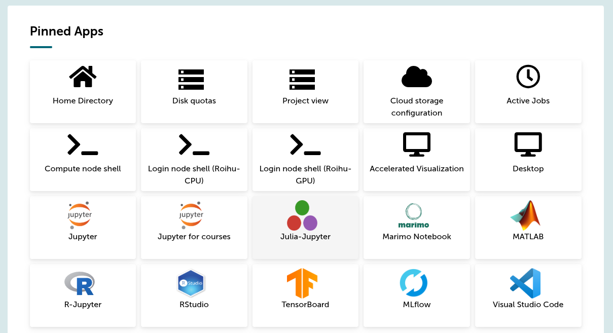

# 4: Flower Model @ Roihu

TODO! Todennäköisesti halutaan kloonata kunkin repo projektikansioon Project Access Tokenia käyttäen (ks. [GitLab: Clone repository using personal access token](https://docs.gitlab.com/user/profile/personal_access_tokens/#clone-repository-using-personal-access-token)) ja hoitaa koodin synkronointi GitLabin kautta eikä `rsync`-komennolla. Perään FirecREST-komento, jolla liipaistaan koulutus käyntiin. Justfile voisi olla ajurina. Jottain tämmöstä tehrään tällä viikolla.

## Työvaiheet

### N: Roihu MLflow (TODO!)

Tämä työvaihe on tässä jo paikanpitäjänä. Myöhemmin tähän tulee lisää tietoa, kuten että kuinka käynnistää MLflow ja kuinka ottaa siihen skriptistä yhteys.

**Kuva 1:** _Roihussa on useita interaktiivisia sovelluksia, jotka voi ajaa suoraan sivustolta `roihu.csc.fi` verkkoselaimesta käsin. Me käynnistämme palvelun MLflow._

## Videolla esitettävä

1. TODO
