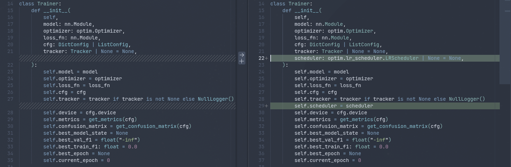

# 5: Flower ViT

Roihu on nyt käytössä, joten on aika kokeilla hieman suurempaa mallia. Materiaali on kirjoitettu ViT (Vision Transformer) -mallin pohjalta, mutta voit käyttää myös muita malleja. Sopivaa mallia voit etsiä [PyTorch Models and pre-trained weights](https://docs.pytorch.org/vision/main/models.html#table-of-all-available-classification-weights)-dokumentaatiosta. Jos haluat paukutella henkseleitä, niin esimerkiksi `ViT_L_16_Weights.IMAGENET1K_V1`-painot koostuvat huikeasta 304 miljoonasta parametrista. Jos käytössä on Adam ja kaikkia parametreja koulutetaan, pelkät painot, gradientit ja Adamin kaksi momenttia vievät fp32-tarkkuudella $4 \times 4 = 16$ tavua per parametri eli noin $304 \times 16 \approx 4.9$ GB muistia. Tämän päälle tulevat aktivaatiot, jotka skaalautuvat eräkoon (_engl. batch size_) mukaan. Voi olla mielenkiintoista kurkata, miltä muistinkäyttö näyttää MLflow:n tilastoissa!

Transformer-arkkitehtuuri käsitellään kunnolla vasta ensi viikolla. Tällä viikolla ViT toimii maistiaisena. Mallia käytetään samalla tavalla kuin MobileNetiä eli esikoulutettuna backbonena, jonka päälle vaihdetaan oma luokittelupää. Sisäistä toimintaa ei tarvitse vielä ymmärtää yksityiskohtaisesti. Riittää, että tiedät seuraavat asiat ViT-B/16-mallista:

- Kuva ($224 \times 224$) pilkotaan $16 \times 16$ pikselin paloihin.
- Kukin pala muunnetaan 768-ulotteiseksi vektoriksi, joka vastaa kielimallin tokenia (sanaa tai sanan osaa).
- Tokenit kulkevat 12 peräkkäisen enkooderilohkon läpi. Nämä ovat varsinainen Transformer-arkkitehtuuri.

Mallin vaihto vaatii konfiguraatiotiedostojen lisäksi muutoksia koodiin, jotta konfiguraatiovetoinen kouluttaminen toimii jatkossakin. Muutokset tehdään siten, että taaksepäin yhteensopivuus pysyy. Lopuksi ViT-malli hienosäädetään aivan kuten MobileNet-malli viikolla 1. Suurena erona on se, että nyt rautana toimii oman kotikoneen sijasta CSC:n Roihu.

Vaikka transformer-arkkitehtuuri on vieras, kannattaa silmäillä Dosovitskiy et al. konferenssijulkaisua [An Image is Worth 16x16 Words: Transformers for Image Recognition at Scale](https://arxiv.org/abs/2010.11929). Tutustu esimerkiksi, kuinka kauan ViT-L/16-mallin koulutus kestäisi ImageNet-21k datasetillä. Myös otsikon 4.5, _"Inspecting Vision Transformer"_, sisältö voi olla mielenkiintoista jo ennen kuin ymmärrät Transformer-arkkitehtuurin yksityiskohdat.

## Työvaiheet

### 1. Tutustu ViT:n rakenteeseen

Ennen kuin muokkaat koodia, katso, miltä mallit näyttävät sisältä. Voit tehdä tämän Marimossa luomalla uuden Notebookin. Se onnistuu komennolla:

```bash title="Oma kone"
uv run marimo edit notebooks/model_architecture_inspection.py
```

Sijoita seuraava koodi soluihin:

```python title="Oma kone (marimon soluissa)"
import torchvision.models as models

mobilenet = models.get_model("mobilenet_v3_small", weights="DEFAULT")
vit = models.get_model("vit_b_16", weights="DEFAULT")

# Yhteen soluun
mobilenet # tai print(mobilenet)

# Toiseen soluun
vit       # tai print(vit)

print(len(mobilenet.features), mobilenet.classifier)
print(len(vit.encoder.layers), vit.heads)

for name, m in [("mobilenet", mobilenet), ("vit", vit)]:
    n_params = sum(p.numel() for p in m.parameters())
    print(f"{name}: {n_params:,} parameters")
```

Marimon ominaisuus, joka sallii tutustua interaktiivisesti PyTorch-mallin kerroksiin, on kertakaikkisen näppärä. Näet, että mallit on koottu eri nimisistä osista:

| Osa                            | MobileNetV3                       | ViT                            |
| ------------------------------ | --------------------------------- | ------------------------------ |
| Piirteitä tuottavat lohkot     | `features` (13 kpl)               | `encoder.layers` (12 kpl)      |
| Viimeinen normalisointi        | (osa `features`-lohkoja)          | `encoder.ln`                   |
| Luokittelupää                  | `classifier`                      | `heads.head`                   |
| Luokittelupään syötteen leveys | `classifier[0].in_features` (576) | `heads.head.in_features` (768) |

Nykyinen `model.py` olettaa kaikkialla MobileNetin nimet (`model.classifier`, `model.features`). ViT:llä näitä attribuutteja ei ole, joten koodi kaatuisi heti. Seuraavissa kahdessa vaiheessa nimet piilotetaan malliperheittäisten apufunktioiden taakse.

!!! tip "Käytätkö jotain muuta mallia?"

    Jos valitsit jonkin muun mallin kuin ViT:n, pidä ViT mukana vertailussa, mutta lisää oma mallisi yllä mainittuun Marimo Notebookiin.

### 2. Python-koodin muokkaus

Konfiguraatioon lisätään uusi avain `model.model_family`. Varsinainen malli valitaan edelleen `model.backbone`-avaimella:

```yaml
model:
  model_family: vit # mobilenetv3 | vit | kenties-joku-sinun-valitsemasi-malli
  backbone: vit_b_16 # vit_b_16 | vit_b_32 | vit_l_16 | vit_l_32
```

Muokkaa tiedostoa `src/flowermodel/modelling/model.py`. Koodin alku löytyy alta avattavasta admonition-laatikosta, ja seuraavat osat seuraavan otsikon alla olevasta toisesta laatikosta. Koodi on siis valmiiksi sinulle toteutettu. Tärkeimmät muutokset ovat:

- Luokittelupään rakentaminen siirretään omaan funktioonsa `_build_classifier_head(in_features, model_cfg)`.
- Nykyinen `_build_backbone` nimetään uudelleen muotoon `_build_mobilenetv3_backbone`, ja se käyttää uutta apufunktiota.
- Uusi funktio `_build_vit_backbone` lataa mallin samalla `models.get_model(...)`-kutsulla, lukee syötteen leveyden kohdasta `model.heads.head.in_features` ja korvaa koko `model.heads`-osan omalla päällä.
- `build_model()` lukee malliperheen komennolla `model_cfg.get("model_family", "mobilenetv3")` ja valitsee sen perusteella oikean rakentajan.

!!! tip

    Jos olet tutkinut tarkasti luokittelupään rakennetta, huomaat, että se ei ole sama malliperheiden välillä. Alkuperäisessä ViT-mallissa ei ole laisinkaan hidden layeriä, joten se on suora MLP tokenista luokkiin. Yksinkertaisuuden vuoksi me kuitenkin liimaamme saman pään kumpaankin malliin. Jos haluat, voit toki tehdä tämän noudattaen orjallisesti mallien alkuperäistä rakennetta.

??? example "model.py: mallin rakentaminen (koodi 1/2)"

    ```python title="src/flowermodel/modelling/model.py"
    import torch.nn as nn

    import torchvision.models as models
    from omegaconf import DictConfig, ListConfig


    def _build_classifier_head(in_features: int, model_cfg) -> nn.Sequential:
        """Build the classifier head shared by all model families."""
        return nn.Sequential(
            nn.Linear(in_features, model_cfg.hidden_dim),
            nn.Hardswish(inplace=True),
            nn.Dropout(p=model_cfg.dropout, inplace=True),
            nn.Linear(model_cfg.hidden_dim, model_cfg.num_classes),
        )


    def _build_mobilenetv3_backbone(model_cfg) -> nn.Module:
        """Load a pretrained MobileNetV3 backbone and replace its classifier head. Note that this will download it to
        the TORCH_HOME. You may want to set this to a custom location when running on a CSC Supercomputer.

        Reference: https://docs.pytorch.org/vision/main/_modules/torchvision/models/mobilenetv3.html"""
        model = models.get_model(model_cfg.backbone, weights="DEFAULT")

        in_features = model.classifier[0].in_features # type: ignore

        model.classifier = _build_classifier_head(in_features, model_cfg)

        return model


    def _build_vit_backbone(model_cfg) -> nn.Module:
        """Load a pretrained Vision Transformer backbone and replace its classifier head. Note that this will download it to
        the TORCH_HOME. You may want to set this to a custom location when running on a CSC Supercomputer.

        Reference: https://docs.pytorch.org/vision/main/_modules/torchvision/models/vision_transformer.html"""
        model = models.get_model(model_cfg.backbone, weights="DEFAULT")

        in_features = model.heads.head.in_features # type: ignore

        model.heads = _build_classifier_head(in_features, model_cfg)

        return model


    # Fine-tuning helpers from step 3 go here


    def build_model(cfg: DictConfig | ListConfig) -> nn.Module:
        """Build and configure the model from the experiment config.

        The model family defaults to 'mobilenetv3' to keep older configs (and
        checkpoints saved from them) working unchanged."""
        model_cfg = cfg.model
        model_family = model_cfg.get("model_family", "mobilenetv3")

        match model_family:
            case "mobilenetv3":
                model = _build_mobilenetv3_backbone(model_cfg)

            case "vit":
                model = _build_vit_backbone(model_cfg)

            case _:
                raise ValueError(
                    f"Unknown model_family: '{model_family}'. "
                    "Expected one of: 'mobilenetv3', 'vit'."
                )

        _apply_fine_tune_strategy(model, model_cfg, model_family)
        model = model.to(cfg.device)

        return model
    ```

Koska backbone ladataan nimen perusteella, myös esimerkiksi `vit_b_32` tai `vit_l_16` toimii pelkästään konfiguraation arvoa vaihtamalla. Koodi on kirjoitettu taaksepäin yhteensopivaksi; vanha MobileNet-konfiguraatio toimii edelleen, koska getterit käyttävät vakioarvoja.

### 3. Mallikohtainen hienosäätö

Funktio `_apply_fine_tune_strategy` tukee kolmea strategiaa: `all`, `classifier_only` ja `last_n_layers`. Nykyinen toteutus viittaa suoraan `model.xxxxx`-attribuutteihin. Nämä viittaukset siirretään apufunktioon `_get_fine_tune_targets`, joka palauttaa parin (piirrelohkot, luokittelupää) malliperheen perusteella:

| `model_family` | Piirrelohkot           | Luokittelupää      |
| -------------- | ---------------------- | ------------------ |
| `mobilenetv3`  | `model.features`       | `model.classifier` |
| `vit`          | `model.encoder.layers` | `model.heads`      |

ViT:ssä on lisäksi yksi yksityiskohta. Enkooderilohkojen jälkeen, ennen luokittelupäätä, on vielä viimeinen LayerNorm-kerros `model.encoder.ln`. Se ei kuulu `encoder.layers`-listaan, joten se jäisi `last_n_layers`-strategiassa jäädytetyksi. Tämän vuoksi lisätään vielä apufunktio `_get_final_norm_layers`, joka palauttaa ViT:lle `[model.encoder.ln]` ja muille tyhjän listan. MobileNetin toiminta ei siis muutu.

??? example "model.py: hienosäätö (koodi 2/2)"

    ```python title="src/flowermodel/modelling/model.py"
    def _get_fine_tune_targets(model: nn.Module, model_family: str) -> tuple[list[nn.Module], nn.Module]:
        """Return the (feature blocks, classifier head) pairs for the given model family."""
        match model_family:
            case "mobilenetv3":
                return list(model.features), model.classifier # type: ignore

            case "vit":
                return list(model.encoder.layers), model.heads # type: ignore

            case _:
                raise ValueError(
                    f"Unknown model_family: '{model_family}'. "
                    "Expected one of: 'mobilenetv3', 'vit'."
                )


    def _get_final_norm_layers(model: nn.Module, model_family: str) -> list[nn.Module]:
        """Return normalization layers that should be trainable together with the
        last N feature blocks (e.g. the final LayerNorm of a ViT encoder)."""
        match model_family:
            case "vit":
                return [model.encoder.ln] # type: ignore

            case _:
                return []


    def _apply_fine_tune_strategy(model: nn.Module, model_cfg, model_family: str) -> None:
        """Freeze/unfreeze model parameters according to the configured strategy."""
        strategy = model_cfg.fine_tune.strategy

        features, classifier = _get_fine_tune_targets(model, model_family)

        # Start by freezing everything
        for param in model.parameters():
            param.requires_grad = False

        match strategy:
            case "all":
                for param in model.parameters():
                    param.requires_grad = True

            case "classifier_only":
                for param in classifier.parameters():
                    param.requires_grad = True

            case "last_n_layers":
                num_layers = model_cfg.fine_tune.num_layers
                trainable_blocks = features[-num_layers:] + _get_final_norm_layers(model, model_family)
                for block in trainable_blocks:
                    for param in block.parameters():
                        param.requires_grad = True
                for param in classifier.parameters():
                    param.requires_grad = True

            case _:
                raise ValueError(
                    f"Unknown fine_tune strategy: '{strategy}'. "
                    "Expected one of: 'classifier_only', 'last_n_layers', 'all'."
                )
    ```

### 4. YAML-konfiguraatio

Luo uusi konfiguraatiotiedosto MobileNet-baselinen rinnalle. Se on lähes sama kuin `mobilenet_v3_small_baseline.yaml`, mutta `model`-osio on uusi, eräkoko on pienempi ja `tracking`-osion nimet on vaihdettu:

```yaml title="configs/experiments/vit_b_16_baseline.yaml"
seed: 42
device: auto # auto | cpu | cuda | mps

data:
  base_dir: data/flower_photos
  batch_size: 64
  num_workers: 6
  augmentations:

    - name: RandomResizedCrop
      size: [224, 224]
      scale: [0.8, 1.0]

    - name: RandomHorizontalFlip
      p: 0.5

    - name: ColorJitter
      brightness: 0.2
      contrast: 0.2
      saturation: 0.2
      hue: 0.1

model:
  model_family: vit # mobilenetv3 | vit
  backbone: vit_b_16 # vit_b_16 | vit_b_32 | vit_l_16 | vit_l_32
  num_classes: 5
  dropout: 0.2
  hidden_dim: 1024
  fine_tune:
    strategy: last_n_layers # classifier_only | last_n_layers | all
    num_layers: 2 # only used when strategy: last_n_layers

loss:
  name: cross_entropy
  label_smoothing: 0.0

optimizer:
  name: adam
  lr: 1.0e-3
  weight_decay: 0.0

training:
  epochs: 15

tracking:
  experiment_name: FlowerModel_ViT_B_16_Baseline
  url: http://localhost:5001
  best_model_path: models/vit_b_16_baseline.pth
```

Voit halutessasi lisätä MobileNet-konfiguraatioon rivin `model_family: mobilenetv3`. Se ei ole pakollista oletusarvon ansiosta, mutta tekee konfiguraatiosta yksiselitteisemmän.

Kun vaihe 4 on tehty, voit tarkistaa REPL:ssä tai Marimossa, montako parametria kukin strategia todella kouluttaa. Huomaa, että `n_layers` vaikuttaa siis tarvittavan muistin määrään. Kun teet lokaalilla koneella savutestiä, voi olla, että sinulla ei riitä VRAM, jos `last_n_layers` ja/tai `batch_size` on liian suuri. Selvitä tarvittavien parametrien määrä ja karkea arvio muistinkäytöstä seuraavalla koodilla:

```python title="Oma kone (uv run python)"
from flowermodel.config import load_config
from flowermodel.modelling.model import build_model

cfg = load_config("configs/experiments/vit_b_16_baseline.yaml")
cfg.device = "cpu"
model = build_model(cfg)

total = sum(p.numel() for p in model.parameters())
trainable = sum(p.numel() for p in model.parameters() if p.requires_grad)
print(f"{trainable:,} / {total:,}")

# Karkea VRAM-arvio (FP32): painot (4 B) + koulutettavien gradientit ja Adam (12 B)
# + väliaktivaatiot (~1.5 B per koulutettava parametri jokaista erän kuvaa kohti)
model_gb = (total * 4 + trainable * 12) / 1e9
act_gb = (trainable * 1.5 * cfg.data.batch_size) / 1e9
print(f"Estimated VRAM: ~{model_gb + act_gb:.1f} GB (model: {model_gb:.2f} GB, activations: {act_gb:.2f} GB)")
```

Kokeile samaa myös MobileNet-konfiguraatiolla. Sinun tarvitsee muuttaa vain YAML:n polku.

### 5. Savutesti omalla koneella

Roihun jonoon ei kannata lähettää koodia, jota ei ole kertaakaan ajettu. Vian etsintä on nopeampaa ja helpompaa lokaalisti. Käynnistä paikallinen MLflow ja aja yksi epookki:

```bash title="Oma kone"
cd ~/Code/syvaoppiminen-2-2026/missa/sinun/pyproject/on/
just flow

uv run python src/flowermodel/train.py \
    --config configs/experiments/vit_b_16_baseline.yaml \
    --override training.epochs=1
```

Aja sama myös MobileNet-konfiguraatiolla. Näin varmistat, että vanha malli toimii muutosten jälkeen edelleen:

```bash title="Oma kone"
uv run python src/flowermodel/train.py \
    --config configs/experiments/mobilenet_v3_small_baseline.yaml \
    --override training.epochs=1
```

Savutestin tarkoitus on löytää kirjoitusvirheet, väärät attribuuttien nimet ja puuttuvat konfiguraatioavaimet. Mallin suorituskyvyllä ei ole tässä vaiheessa väliä. Tarkista MLflow:sta, että ajo valmistui ja metriikat sekä artefaktit tallentuivat. Jos sinulla on Nvidian GPU ja haluat nähdä MLflowssa muistinkäytön, tulee sinun ajaa `uv add nvidia-ml-py` ensin.

Jos kaikki meni hyvin, voit kouluttaa myös ViT:n suuremmalla määrällä epookkeja. Aja ylempi komento siten, että `training.epoch` on esimerkiksi 30. Opettajan Nvidia 3060 Ti:llä aikaa menee noin 30 sekuntia per epookki, 6 minuuttia yhteensä. GPU syö noin 200 W sähköä kaiken aikaa ja VRAM:n käyttö on noin 3.8-3.9 GB. VRAM:n määrää jos kurkkaa `nvidia-smi`-komennolla, paljastuu, että sitä menee noin 2300 MiB. Aiemman skriptin arvio osio jotakuinkin oikeaan.

Baselinen suoritus näyttää olevan `best/epoch=7`, `best/f1_train=0.981` ja `best/f1_val=0.947`.

!!! warning

    Jos paikallisen koneen muisti loppuu, pienennä eräkokoa komentoriviltä, esimerkiksi `--override data.batch_size=16`. Konfiguraatiotiedostoon ei tarvitse koskea.

### 6. Slurm-konfiguraatio

Tee kopio edellisen viikon `roihu_train_mobiletnet.sh`-skriptistä ja nimeä se `roihu_train_vit.sh`. Tee tarvittavat muutokset, joihin lukeutuu ainakin:

- Konfiguraation vaihto `configs/experiments/vit_b_16_baseline.yaml`-tiedostoon
- Experimentin nimen vaihto `FlowerModel_ViT_B_16_Roihu`-arvoksi
- Mallin tallennuspolun vaihto `$DL2_SCRATCH/models/vit_b_16_roihu.pth`-arvoksi

### 7. Koulutus Roihussa

Commitoi ja puske muutokset omalta koneeltasi:

```bash title="Oma kone"
cd ~/Code/syvaoppiminen-2-2026/<nimi>
git add .
git commit -m "Add ViT backbone support"
git push
```

Kirjaudu Roihuun SSH:lla, päivitä klooni ja lähetä ViT-koulutus jonoon:

```bash title="CSC Roihu"
cd $DL2_PROJ/missa-sinun/git/repo/on
git pull

cd flower-model-demo-tai-mika-hakemiston-nimi-onkaan
sbatch scripts/roihu_train_vit.sh
# Aja squeue --me, tail -f slurm-<jobid>.out jne.
```

Ensimmäisellä kerralla työ lataa ViT:n painot `TORCH_HOME`-hakemistoon `/scratch`-levyalueelle, ja myöhemmät ajot käyttävät ladattuja painoja.

Työ käyttää edelleen `gputest`-partitiota. Baseline-konfiguraation 15 epookkia mahtuvat sen aikarajaan. Itse asiassa 15 epookkia mahtuu tähän rajaan yllättävän helposti: ViT kouluttautui CSC:n raudalla hitusen reilussa minuutissa! GPU söi sähköä yli 500 wattia koulutuksen läpi ja muistinkäyttö näyttää samaa kuin kotiraudalla.

Jos työ kaatuu, tutki virheilmoitusta `slurm-<jobid>.out`-tiedostosta. Todennäköisin syy on jokin typo tai väärä polku, jos savutesti toimi lokaalisti.

### 8. Oppimisnopeuden ajastin (valinnainen)

!!! tip

    Tämä tehtävä on valinnainen, syventävä lisätehtävä, jolla on ainoastaan arvosanaa korottava vaikutus. Jos et tee tätä, hyppää suoraan seuraavaan kohtaan eli mallin hienosäätöön.

Tähän asti oppimisnopeus on pysynyt koko koulutuksen ajan vakiona (jos unohdetaan Adam-optimoijan parametrikohtaiset skaalaukset). Transformer-malleja hienosäädettäessä on tavallista käyttää ajastinta (_engl. learning rate scheduler_), joka muuttaa oppimisnopeutta koulutuksen aikana. Toteutetaan ajastin, jossa on kaksi vaihetta:

1. **Lämmittely** (_engl. warmup_): oppimisnopeus alkaa 1 %:sta perusarvosta ja kasvaa lineaarisesti perusarvoon `warmup_epochs` epookin aikana.
2. **Kosinilasku** (_engl. cosine decay_): loppuepookkien aikana oppimisnopeus laskee kosinikäyrän mukaisesti arvoon `eta_min`.

Ajastinta päivitetään kerran epookissa. Konfiguraatiossa ajastin on `optimizer`-osion alla:

```yaml
optimizer:
  name: adam
  lr: 1.0e-3
  weight_decay: 0.0
  scheduler:
    name: cosine # none | cosine
    warmup_epochs: 2
    eta_min: 1.0e-6
```

Muutoksia tarvitaan kolmeen tiedostoon. Kaikki muutokset ovat taaksepäin yhteensopivia: konfiguraatio, jossa ei ole `scheduler`-osiota, kouluttaa vakio-oppimisnopeudella kuten ennenkin.

#### A: optim.py

Metodi `build_optimizer()` (`src/flowermodel/modelling/optim.py`) välittää kaikki `optimizer`-osion avaimet `name`-avainta lukuun ottamatta optimoijalle. Tämä ei ehkä ole aivan paras tapa abstrahoida optimoijan alustusta, mutta pidetään koodimuutokset yksinkertaisina ja korjataan koodi helpoimman kautta. Adam ei tunne `scheduler`-argumenttia, joten se pitää poistaa ennen optimoijan luontia:

```python title="src/flowermodel/modelling/optim.py"
    opt_kwargs = dict(optimizer_cfg)
    opt_name = opt_kwargs.pop("name")
    opt_kwargs.pop("scheduler", None)
```

Lisää samaan tiedostoon uusi funktio `build_scheduler`. Funktio käyttää PyTorchin `LambdaLR`-ajastinta, joka kertoo perusoppimisnopeuden epookin perusteella lasketulla kertoimella:

??? example "build_scheduler"

    ```python title="src/flowermodel/modelling/optim.py"
    import math

    # ...

    def build_scheduler(cfg, optimizer: optim.Optimizer) -> optim.lr_scheduler.LRScheduler | None:
        """Build an optional learning-rate scheduler from config.

        Configs without an `optimizer.scheduler` section (all older configs) keep
        their constant learning rate and return None. The scheduler is stepped once
        per epoch by the Trainer, so the epoch-0 learning rate is applied when the
        scheduler is built."""
        if "scheduler" not in cfg.optimizer:
            return None

        scheduler_cfg = cfg.optimizer.scheduler
        scheduler_kwargs = dict(scheduler_cfg)
        scheduler_name = scheduler_kwargs.pop("name")
        warmup_epochs = scheduler_kwargs.pop("warmup_epochs", 0)
        min_lr = scheduler_kwargs.pop("eta_min", 0.0)
        epochs = cfg.training.epochs

        match scheduler_name:
            case "none":
                return None

            case "cosine":
                base_lr = optimizer.param_groups[0]["lr"]
                min_lr_factor = min_lr / base_lr if base_lr > 0 else 0.0
                warmup_epochs = min(warmup_epochs, max(epochs - 1, 0))
                warmup_start_factor = 0.01
                decay_epochs = max(epochs - 1 - warmup_epochs, 1)

                def lr_lambda(epoch: int) -> float:
                    if warmup_epochs > 0 and epoch < warmup_epochs:
                        return warmup_start_factor + (
                            1.0 - warmup_start_factor
                        ) * epoch / warmup_epochs
                    progress = (epoch - warmup_epochs) / decay_epochs
                    progress = min(max(progress, 0.0), 1.0)
                    return min_lr_factor + (1.0 - min_lr_factor) * 0.5 * (
                        1.0 + math.cos(math.pi * progress)
                    )

                return optim.lr_scheduler.LambdaLR(optimizer, lr_lambda=lr_lambda)

            case _:
                raise ValueError(
                    f"Unknown scheduler: '{scheduler_name}'. "
                    "Expected one of: 'cosine', 'none'."
                )
    ```

#### B: training.py

Luokka `Trainer` (`src/flowermodel/modelling/training.py`) saa uuden valinnaisen argumentin `scheduler: optim.lr_scheduler.LRScheduler | None = None`, joka tallennetaan `self.scheduler`-attribuuttiin. Alla on kuva madaltamasta kynnystä ryhtyä tähän hommaan.



**Kuva 1:** _Muutokset Trainer-luokkaan ja sen init-metodiin._

Lisäksi `fit()`-metodissa ajastinta askelletaan kerran epookin lopussa validoinnin ja parhaan mallin tarkistuksen jälkeen, ja sen hetkinen oppimisnopeus kirjataan MLflow:iin:

```python title="src/flowermodel/modelling/training.py"
            # Olemassa oleva koodi, jonka alle se tulee, on...
            # if val_f1 > self.best_val_f1:
            #   ...

            if self.scheduler is not None:
                self.scheduler.step()
                self.tracker.log_metric(
                    "train/lr", self.optimizer.param_groups[0]["lr"], step=epoch
                )
```

#### C: train.py

Viimeinen muokattava tiedosto on `src/flowermodel/train.py` eli varsinainen ajuriskripti. Ajastin rakennetaan optimoijan jälkeen ja annetaan `Trainer`-luokalle:

```python title="src/flowermodel/train.py"
from flowermodel.modelling.optim import ..., build_scheduler

# ...
    # Tämän rivin alle, siis:
    # optimizer = build_optimizer(...)
    scheduler = build_scheduler(cfg, optimizer)

# ...
        # Ja pieni lisäys tähän riviin.
        trainer = Trainer(..., scheduler=scheduler)
```

#### Savutestaus

Testaa muutos paikallisesti muutaman epookin ajolla ja tarkista MLflow:sta, että `train/lr`-käyrä näyttää odotetulta. Kouluta sitten Roihussa ViT ajastimen kanssa ja vertaa tulosta vakio-oppimisnopeudella koulutettuun ajoon. Savutestauksen voit käynnistää overriden avulla näin:

```bash title="Oma kone"
uv run python src/flowermodel/train.py \
  --config configs/experiments/vit_b_16_scheduler.yaml \
  --override training.epochs=3
```

Testaa, että myös vanha konfiguraatio on ajettavissa ilman ongelmia. Vaihda yllä olevasta komennosta YAML:n polku ja aja esimerkiksi vain 1 epookki. Voit testata sekä ViT että MobileNet-konfiguraatiot varmuuden vuoksi.

### 9. Mallin hienosäätö

Tavoitteena on, että ViT-mallin **`best/f1_val` on 95 % tai parempi**. Älä kuitenkaan tyydy helppoon ratkaisuun, vaan käytä hieman aikaa kokeillaksesi, miten eri hyperparametrit vaikuttavat mallin suorituskykyyn.

Jos toteutit kohdan 8, voit myös kokeilla ajastimen hyperparametreja `optimizer.scheduler.warmup_epochs` ja `optimizer.scheduler.eta_min`.

Esikoulutetun mallin hienosäätöön pätee nyrkkisääntö: mitä suurempi osa backbonesta avataan koulutettavaksi, sitä varovaisemmin painoja kannattaa muuttaa. Tämän kenties olet jo itse huomannut MobileNetiä koulutttaessa. Oikeat arvot sinun tulee kuitenkin löytää kokeilemalla. Kokeiluja voi tehdä joko muokkaamalla konfiguraatiotiedostoa tai käyttämällä `--override`-mekanismia. 

!!! tip

    Huomannet, että Roihun kanssa override on sinänsä helpompi, että sinun ei tarvitse tehdä uutta committia joka kerta, kun haluat kokeilla uutta hyperparametriyhdistelmää.

    Suuremman mallin kanssa tämä voisi olla myös haluttu ominaisuus! Git branchin ja commitin voisi sitoa MLflow-ajoihin metadatan avulla. Commit message voisi tällöin sisältää hyperparametrien arvojen perusteluita. Ei ole yhtä oikeaa tapaa hoitaa MLOpsia; kussakin projektissa tulee arvioida, mikä on järkevintä kyseisen projektin kannalta.

Kun tavoite on saavutettu, vertaa ViT:tä Roihussa koulutettuun MobileNetiin:

- F1-metriikat validointi- ja testidatalla.
- Koulutuksen kesto.
- Koulutettavien parametrien määrä (ks. työvaihe 4).

Pohdi, onko F1-metriikan parannus kustannusten arvoinen. Ota huomioon myös vaiheessa 1 näkemäsi koko ja se, että viikolla 1 käytetty selaininferenssi ajaa mallia käyttäjän omalla laitteella.

!!! note

    Opettaja saavutti seuraavat tulokset käyttämättä scheduleria:

    * `best/f1_train=0.996`
    * `best/f1_val=0.969`
    * `test/F1Score=0.963`

    Seuraavat tulokset saavutettiin schedulerin kera:

    * `best/f1_train=0.997`
    * `best/f1_val=0.970`
    * `test/F1Score=0.966`
    
    Schedulerin hyperparametrejä ei säädetty erikseen, mutta muita hyperparametrejä tuunattiin.

## Videolla esitettävä

1. Esittele muutokset koodiin.
    - Näytä `model.py`-tiedostosta, miten malliperhe valitaan.
    - Näytä `vit_*.yaml` konfiguraatiot 
    - Näytä `roihu_train_vit.sh`-skriptin sisältö.
    - Jos tuunasit muuta mallia kuin ViT:ä, näytä samat konfiguraatiot soveltuvilta osin.

2. Aja paikallinen savutesti sekä ViT- että MobileNet-konfiguraatiolla.
    - Yksi epookki riittää.
    - Batch size saa olla pieni.

3. Käynnistä ViT-koulutus `sbatch`-komennolla. Tarkastele valmistunutta työtä `seff`-komennolla.

4. Esittele hyperparametrien hienosäädön tulokset.
    - Kommentoit lyhyesti, mitä hyperparametreja päädyit säätämään ja miksi.
    - Näytät MLflow:ssa vähintään 5 eri runia eri hyperparametreilla yleisnäkymässä.

5. Esittelet tarkemmin vähintään yhden runin.
    - Näytät parametrit, ja
    - metriikat (F1, hämmennysmatriisi)

6. Vertaile ViT:n ja MobileNetin mallien suhteen:
    - Koulutuksen kestoa
    - Koulutettavien parametrien määrä (mielellään Marimo Notebookissa)
    - Pohdi, onko F1-metriikan parannus kustannusten arvoinen.

7. (Valinnainen) Näytä oppimisnopeuden ajastimen toteutus. Näytä myös `train/lr`-käyrä MLflow:ssa. Jos tutustuit aiheeseen syvemmin, kuvaile ajastamisen logiikkaa ja sen vaikutusta koulutukseen.

Kokonaisuutena videosta tulee ilmetä, että osaat vaihtaa koulutusprojektin backbonen suurempaan malliin rikkomatta aiempia konfiguraatioita tai checkpointeja. Ymmärrät, miksi muutokset testataan ensin paikallisesti ennen supertietokoneen resurssien käyttöä, ja osaat ajaa saman koodin Roihussa eri konfiguraatioilla ilman, että työskripti haarautuu.

## Yhteenveto

Tähän viikkoon loppuu `flower-model`:n matka tällä kurssilla. Seuraavissa viikoissa käsittelemme muita malleja ja todennäköisesti ajamme koodin yksinkertaisimmalla mahdollisella tavalla, kuten siirtämällä koodia `scp`:n avulla Roihuun. Tämä tehdään, jotta voimme keskittyä muihin asioihin kuin koulutuksen konfiguraatioon (esim. parallelismiin).

Toivon mukaan sinulla on nyt konfiguraatiovetoisesta kouluttamisesta ja MLOpsista ajatusmalli, jota voit soveltaa tulevissa projekteissasi. Tässä esitelty lähestymistapa on yksinkertainen ja itse koodattu toimimaan hyvin suppean mallivalikoiman kanssa. Käytännön projektissa saatat käyttää jotakin valmista viitekehystä. Yksi valmiista vaihtoehdoista, [LightningCLI](https://lightning.ai/docs/pytorch/stable/cli/lightning_cli.html) tiivistää konfiguraatiovetoisen kouluttamisen käytänteet näin:

> "When running deep learning experiments, there are a couple of good practices 
> that are recommended to follow:
> 
> * Separate configuration from source code
> * Guarantee reproducibility of experiments
>
> -- Lightning.ai

Käytit sitten valmista tai teit itse, konfiguraatiovetoisen kouluttamisen periaatteet ja hyödyt pysyvät. Ethän rakenna tuotantoon menevää mallia siten, että sinulla on hakemistollinen Jupyter Notebookeja, jotka ovat täynnä kaoottista, toisintamatonta ja vaikeasti ylläpidettävää koodia.
